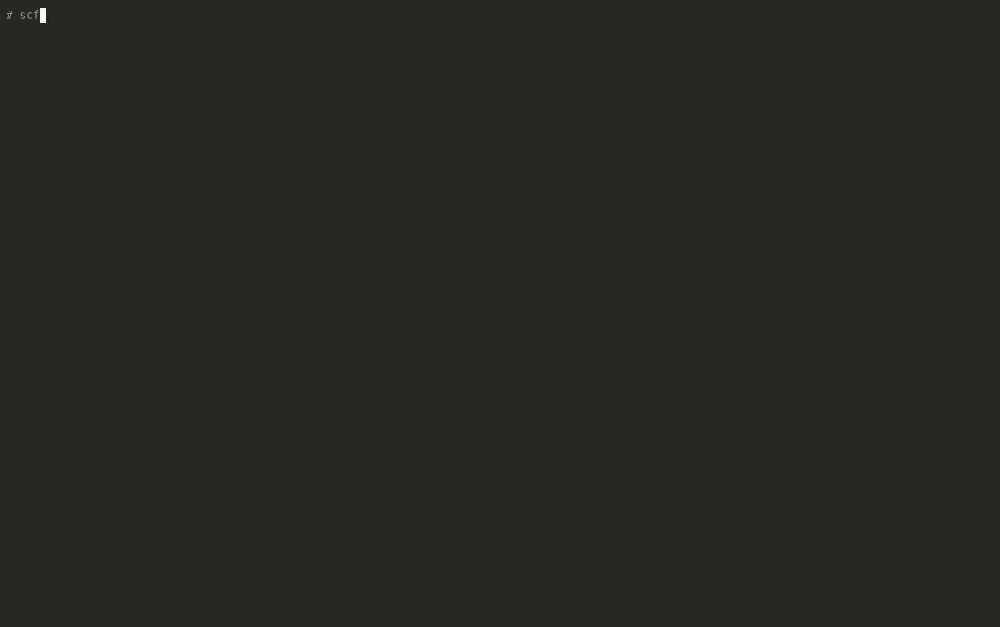

# scflow

Computes superconducting Tc from a crystal structure using Quantum ESPRESSO and EPW,
and checks the result before recording it.

I started this as a set of scripts for high-pressure hydrides. It grew into a small
package because I kept running into results that looked fine and turned out to be wrong.
The main ones:

- The CaH6 input had hydrogen on the wrong Wyckoff site (12e instead of 12d). Symmetry
  checks passed, because both sites give Im-3m with 48 operations. But H sat 0.91 Å from Ca,
  the DFT pressure was 427 GPa instead of 200, and every phonon at Gamma was imaginary. I spent
  a while treating that as an anharmonicity problem before finding the real cause.
- vc-relax ran but its output was never used, so later steps ran at the input lattice.
- One "agreement with experiment" only worked because mu* had been set to 0.18.

So every run now goes through a set of checks before it is written to the database.



## What it does

```
pw.x vc-relax -> pw.x scf -> ph.x (DFPT) -> q2r/matdyn -> pw.x nscf
  -> epw.x (Wannierize) -> epw.x (a2F / Eliashberg) -> checks -> sqlite DB
```

Checks run at each stage:

- Before anything runs: interatomic distances against covalent radii, space group from
  spglib (optionally against `expected_spacegroup`), atomic masses. `scflow run` stops if
  any of these fail.
- After SCF: convergence, QE's symmetry count against spglib, DFT pressure against the
  target pressure.
- Phonons: imaginary modes on the DFPT grid, acoustic sum rule at Gamma.
- Wannier:
  - how close `dis_froz_max` sits to a band energy (an edge on a band gave me NaN couplings);
  - disentanglement convergence;
  - spreads.
- EPW:
  - NaNs, and imaginary modes on the fine grid;
  - lambda and omega_log recomputed from the a2F file and compared with EPW;
  - choice of phonon smearing;
  - `fsthick` and `wscut` relative to the highest phonon frequency;
  - mu* outside 0.08–0.16.
- Tc: Allen-Dynes, Allen-Dynes with the f1·f2 corrections, and a separate isotropic
  Eliashberg solve from the a2F (Allen-Dynes runs low once lambda is above ~1.5).

Each run in the database gets a tier, computed from the checks:

- `invalid`: a check failed.
- `preliminary`: no failures, but no convergence evidence yet.
- `converged`: two runs that differ only in the fine grid agree on lambda within 10%.
- `benchmark`: converged, and within 25% of a reference Tc at roughly the same pressure.

## Running it

The easiest way is the container. It builds QE 7.4.1, EPW, Wannier90 and the pslibrary
PBE pseudopotentials from source, which takes about 5 minutes on 24 cores.

```bash
docker build -f docker/Dockerfile -t scflow:latest .
pip install -e .

scflow check compounds/Nb_0GPa.yaml
scflow submit compounds/Nb_0GPa.yaml --backend docker --nproc 16
scflow db list
```

Output goes to `runs/<prefix>/` and the database is `runs/scflow.db`. Every finished run also
writes a JSON record containing:
- the config and code versions;
- every check and all the Tc numbers;
- SHA-256 hashes of the inputs and outputs.

Other ways to run:

- Native QE: set `SCFLOW_QE_BIN` and `SCFLOW_PSEUDO_DIR`, then `scflow run compounds/X.yaml`.
  `scripts/setup_native.sh` builds everything on Ubuntu/WSL2.
- Slurm: `scflow submit X.yaml --backend slurm --nproc 64 --partition ... --account ...`.
  This writes and submits a job script that runs the container under Apptainer. Add
  `--native` to use a QE install on the cluster.
- AWS Batch: `scflow submit X.yaml --backend aws-batch ...`, with a CloudFormation template in
  `deploy/aws/`. I haven't run this against a real account yet.

`scflow doctor compounds/X.yaml` checks that a machine has everything it needs. Useful flags
for `run`:
- `--start-from` / `--stop-after STEP`: run part of the workflow.
- `--reset-epw`: needed after changing Wannier settings.
- `--dry-run`: write the inputs only.

## Adding a compound

1. Copy `compounds/template.yaml` and fill it in. Add `expected_spacegroup` and a `reference:`
   block if you have one.
2. `scflow check compounds/X.yaml`
3. `scflow run compounds/X.yaml --stop-after scf`, then `scflow validate compounds/X.yaml`.
   Look at the pressure and symmetry before spending hours on phonons.
4. After the NSCF, set `dis_froz_max` from the window scan it prints. Then
   `scflow run X.yaml --reset-epw --start-from epw1`.
5. Rerun with a denser `fine_kgrid` / `fine_qgrid` until lambda stops moving.

The notes in `.claude/skills/simulate-superconductor/SKILL.md` cover Wannier windows, semicore
bands and the errors I've hit so far.

## Current results

| Compound | Tier | Notes |
|---|---|---|
| CaH6, 200 GPa | converged | 12d structure, a = 3.398 Å, stable on the 4×4×4 q-grid without SSCHA. lambda = 1.96, omega_log = 110 meV, Tc = 239 K (Eliashberg) / 181 K (Allen-Dynes), mu* = 0.10, harmonic. Fine grids k24/q12 and k32/q16 agree to 7% at 0.1 eV electron smearing. Experiment is 215 K at 172 GPa. |
| Nb, 0 GPa | preliminary | lambda = 1.70, Tc = 14.6 K (Eliashberg) vs 9.25 K measured. Single 10³ fine grid. Disentanglement not converged. |
| NbN, 0 GPa | invalid | −320 cm⁻¹ mode at X. |
| H3S, H3Se, MgCNi3 | need re-running | old outputs not kept, or run before the vc-relax fix |
| PdH, 0 GPa | needs SSCHA | real anharmonic instability at X |
| Nb3Sn | not run | |

Older notes for each compound are in `results/`.

CaH6 caveats:
- The convergence evidence is only two grid points.
- The Wannier coarse grid is 4³. An 8³ k-grid on the 4³ q-grid gave NaN couplings in EPW 5.9,
  and I haven't tracked down why.

## ML screening

`ml/` has quick models for deciding what is worth a full calculation:
- a superconductor classifier and rough Tc estimate trained on 3DSC (SuperCon matched to
  Materials Project structures);
- a hull-distance model trained on Materials Project;
- a MACE-MP-0 script that relaxes a structure, computes phonons and builds a convex hull.

Results and limitations are in `ml/README.md`. The short version: the classifier is useful
for ranking, and the Tc estimate is rough. The training data contain almost no hydrides, so
none of this applies to high-pressure hydrides.

## Notes

- Use `ibrav=0` unless every coordinate is 0 or 1/2. Otherwise QE finds fewer symmetry
  operations.
- vc-relax runs unless `skip_vcrelax: true`. The relaxed structure is saved to
  `runs/<prefix>/relaxed_structure.yaml` and used for every later step.
- The NSCF uses an explicit `K_POINTS {crystal}` list, because EPW needs the full grid.
- Completion is judged from the output file, not the exit code. EPW sometimes exits
  non-zero after finishing because of floating-point exception reporting.
- A step whose input changed is rerun or refused, never silently reused.
- QE 7.4.1 `ph.x` segfaults on hexagonal structures on Apple Silicon. Use Linux for those.

## Layout

```
scflow/      package: workflow, input generators, parsers, checks, Eliashberg solver, DB, CLI
compounds/   compound configs and template.yaml
examples/    a structure the pre-flight checks reject
ml/          screening models
tests/       pytest, using trimmed real QE/EPW outputs
docker/      container build
deploy/aws/  AWS Batch template
scripts/     native install script
results/     per-compound notes
docs/        demo recording
```

## References

- P. Giannozzi et al., J. Phys.: Condens. Matter 29, 465901 (2017). Quantum ESPRESSO.
- S. Poncé et al., Comput. Phys. Commun. 209, 116 (2016). EPW.
- P. B. Allen and R. C. Dynes, Phys. Rev. B 12, 905 (1975).
- A. Dal Corso, Comput. Mater. Sci. 95, 337 (2014). pslibrary.
- H. Wang et al., PNAS 109, 6463 (2012). CaH6 prediction.
- L. Ma et al., Phys. Rev. Lett. 128, 167001 (2022). CaH6 experiment.
- A. P. Drozdov et al., Nature 525, 73 (2015). H3S experiment.
- L. Monacelli et al., J. Phys.: Condens. Matter 33, 363001 (2021). SSCHA.

## License

MIT, see `LICENSE`. The container includes Quantum ESPRESSO, EPW, Wannier90 and pslibrary,
which are GPL and built from their public sources.
